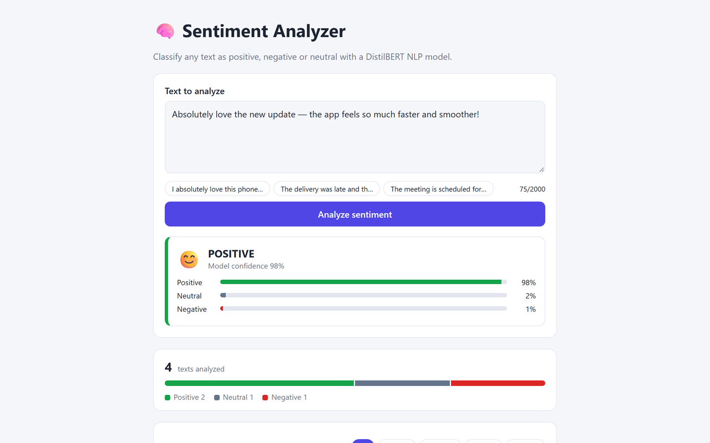

# Sentiment Analyzer

A web app that classifies the sentiment of any text as **Positive**, **Negative** or **Neutral** using the **DistilBERT** NLP model, and keeps a searchable history of results in SQLite.

**Stack:** Svelte · Vite · Python · Flask · Hugging Face Transformers (DistilBERT) · SQLite

## Screenshot



## Features

- Analyze any text (up to 2,000 characters) and see the predicted label, model confidence and the positive / neutral / negative probability split
- Works with English and many other languages (the model is multilingual)
- History of every analysis stored in SQLite, filterable by label, with delete and clear
- Live statistics: total texts analyzed and the label distribution
- Batch endpoint for analyzing up to 20 texts at once
- Light and dark mode

## How the model works

The backend uses [`lxyuan/distilbert-base-multilingual-cased-sentiments-student`](https://huggingface.co/lxyuan/distilbert-base-multilingual-cased-sentiments-student), a DistilBERT model distilled for three-way sentiment. It returns a probability for each of POSITIVE, NEUTRAL and NEGATIVE, and the app picks the highest.

Plain factual sentences often get a weak positive lean that isn't real sentiment, so any prediction whose top probability is below a threshold (default `0.55`, configurable with `NEUTRAL_THRESHOLD`) is reported as **NEUTRAL**. Results from the real model:

| Text | Label | Confidence |
| --- | --- | --- |
| I absolutely love this phone, the battery lasts forever! | POSITIVE | 97% |
| The delivery was late and the food was cold. | NEGATIVE | 75% |
| It was okay, nothing special. | NEUTRAL | 65% |
| The meeting is scheduled for 3pm on Tuesday. | NEUTRAL | 44% (weak positive lean → neutral) |

An earlier version used the binary SST-2 DistilBERT model, but it rated neutral sentences like the meeting example as 95% positive, so it was replaced. You can still try any Hugging Face text-classification model with the `SENTIMENT_MODEL` environment variable.

## Project structure

```
sentiment-analyzer/
├── backend/
│   ├── app.py           # Flask API (create_app factory)
│   ├── analyzer.py      # DistilBERT wrapper + neutral thresholding
│   ├── database.py      # SQLite persistence and stats
│   └── test_app.py      # pytest suite (uses a fake model, no download needed)
└── frontend/
    └── src/
        ├── App.svelte           # input, history, filters
        └── lib/                 # ResultCard, StatsBar
```

## Getting started

Requirements: Python 3.10+ and Node.js 20+.

```bash
# 1. API
cd backend
python -m venv .venv
.venv\Scripts\activate          # macOS/Linux: source .venv/bin/activate
pip install -r requirements.txt
python app.py                   # http://127.0.0.1:5000 - the model (~540 MB) downloads on the first request

# 2. Web app (new terminal)
cd frontend
npm install
npm run dev                     # http://localhost:5173
```

### Tests

```bash
cd backend
pip install -r requirements-dev.txt
pytest
```

The tests inject a fake analyzer, so they run in about a second without PyTorch or a model download.

## API

| Method | Endpoint | Description |
| --- | --- | --- |
| POST | `/api/analyze` | `{ "text": "..." }` → label, confidence, scores (saved to history) |
| POST | `/api/analyze/batch` | `{ "texts": ["...", "..."] }` (max 20) |
| GET | `/api/history?limit=20&label=POSITIVE` | Recent analyses |
| DELETE | `/api/history/:id` | Delete one analysis |
| DELETE | `/api/history` | Clear history |
| GET | `/api/stats` | Totals and label distribution |

Example:

```bash
curl -X POST http://127.0.0.1:5000/api/analyze -H "Content-Type: application/json" \
  -d "{\"text\": \"I absolutely love this phone, the battery lasts forever!\"}"
```

```json
{ "id": 1, "text": "I absolutely love this phone, the battery lasts forever!", "label": "POSITIVE", "confidence": 0.9731, "positive": 0.9731, "neutral": 0.0151, "negative": 0.0118, "created_at": "2026-10-14T18:20:11Z" }
```

## Author

**Jad Obeid** — [LinkedIn](https://www.linkedin.com/in/jad-obeid-dev) · [GitHub](https://github.com/jad-obeidd)
